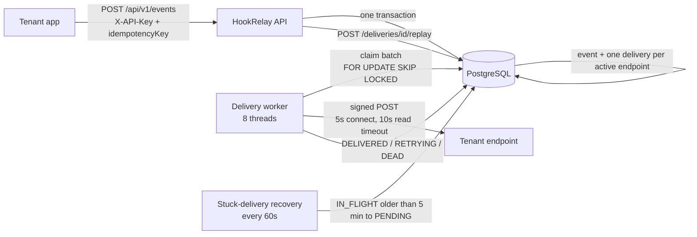

# HookRelay

[](https://github.com/chandhuru018/hookrelay/actions/workflows/ci.yml)

A multi-tenant webhook delivery platform, in the spirit of Stripe or GitHub webhooks. Apps register endpoints and publish events through an API. HookRelay delivers each event to every active endpoint with **at-least-once** semantics, signed payloads, retries with backoff, dead-lettering, replay, and metrics.

**Stack:** Java 21, Spring Boot 4.1, Spring Data JPA (Hibernate 7), Spring Security 7, JdbcTemplate, PostgreSQL 16, Flyway, Micrometer/Actuator, springdoc-openapi, Docker Compose, JUnit 5 + Mockito, k6.
## Live demo

**[Open the live API (Swagger UI)](https://hookrelay-bqsh.onrender.com/swagger-ui.html)**

Hosted for free on Render, with a Neon Postgres database in Singapore.

> **Note:** the free instance sleeps after 15 minutes without traffic, so the first request can take about a minute. While it sleeps, webhook deliveries pause and resume when it wakes.

### Try it in 2 minutes

1. Open the link above and run `POST /api/v1/tenants` with any name. Copy the `apiKey` from the response (it is shown once).
2. Click **Authorize** and paste the key.
3. Get a free receiver URL from [webhook.site](https://webhook.site) and register it with `POST /api/v1/endpoints`.
4. Send an event with `POST /api/v1/events`. The signed request shows up on webhook.site with `X-HookRelay-Signature` and `X-HookRelay-Timestamp` headers.
5. Try registering `http://localhost:8080/x`. It is rejected with 400 by the SSRF protection.

### Demo limits (free tier)

- 5 endpoints per tenant, 1,000 stored events per tenant, 8 KB payloads
- Data is deleted after 3 days
- Metrics and admin routes are protected by HTTP Basic authentication
## Architecture



**Delivery states:** `PENDING` → `IN_FLIGHT` → `DELIVERED`, or → `RETRYING` (backoff) → … → `DEAD` after 6 failed attempts. A dead delivery can be replayed back to `PENDING`.

## Engineering problems solved

| Problem | Solution |
|---|---|
| Two workers pick the same delivery | `SELECT … FOR UPDATE SKIP LOCKED` inside a transaction; verified by a concurrency test |
| Event saved but its deliveries never created | Event and deliveries are written in a single `@Transactional` method |
| Duplicate publish calls | `Idempotency-Key` plus a `UNIQUE (tenant_id, idempotency_key)` constraint; duplicates return `409` |
| Receiver is down or flaky | Exponential backoff with jitter (`2^attempt` seconds plus 0-2 s, capped at 300 s), 6 attempts, then `DEAD` |
| A dead endpoint wastes resources | Endpoint is disabled after 10 consecutive failures |
| Receivers cannot trust the sender | HMAC-SHA256 signature over `timestamp.body`, sent in headers |
| One slow endpoint blocks the rest | Bounded batches, a fixed thread pool, and connect/read timeouts |
| Worker crashes mid-delivery | `claimed_at` timestamp plus a recovery job that returns stale `IN_FLIGHT` rows to `PENDING` |
| Lost failed events | `DEAD` state plus a replay endpoint scoped to the owning tenant |

### A race condition found by testing

`DeliveryClaimer.claimBatch()` originally ran the `SELECT … FOR UPDATE SKIP LOCKED` and the follow-up `UPDATE … IN_FLIGHT` as two auto-committed statements. The row lock was released as soon as the `SELECT` finished, before the rows were marked as claimed, so two workers could take the same delivery. A concurrency test (8 threads, 100 deliveries) produced **140 claims for 100 deliveries**. Adding `@Transactional` to the method fixed it: **100 unique claims**.

## Quick start

Requires Docker Desktop.

```bash
docker compose up -d --build
```

- API docs and a try-it-out UI: <http://localhost:8080/swagger-ui.html>
- Metrics: <http://localhost:8080/actuator/metrics>

Walkthrough in Swagger:

1. `POST /api/v1/tenants` with `{"name": "demo"}` and copy the `apiKey` from the response (shown only once).
2. Click **Authorize** and paste the key.
3. `POST /api/v1/endpoints` with `{"url": "https://your-receiver.example/hook"}` and note the `secret`.
4. `POST /api/v1/events` with a unique `idempotencyKey`.
5. `GET /api/v1/stats` to see delivery counts by status.

To run the app from an IDE instead, start only the database with `docker compose up -d db`.

## API

| Method | Path | Auth | Purpose |
|---|---|---|---|
| POST | `/api/v1/tenants` | none | Register a tenant, returns the API key once |
| POST | `/api/v1/endpoints` | `X-API-Key` | Register a webhook URL, returns its signing secret |
| POST | `/api/v1/events` | `X-API-Key` | Publish an event (`201`, or `409` on a duplicate key) |
| GET | `/api/v1/stats` | `X-API-Key` | Delivery counts by status and success rate |
| POST | `/api/v1/deliveries/{id}/replay` | `X-API-Key` | Re-queue a `DEAD` delivery (`409` if not dead, `404` if not yours) |

`payload` is sent as a JSON-encoded string, for example `"payload": "{\"orderId\": 1}"`.

## Verifying a webhook (receiver side)

Each delivery carries two headers: `X-HookRelay-Timestamp` and `X-HookRelay-Signature`. Compute the HMAC-SHA256 of `timestamp + "." + rawBody` with your endpoint secret, hex-encode it, and compare it to the signature in constant time. Reject requests whose timestamp is too old, to prevent replays. Delivery is at-least-once, so receivers must be idempotent.

## Observability

Micrometer metrics exposed through Actuator:

- `hookrelay.deliveries` counter, tagged `outcome=delivered|retry|dead`
- `hookrelay.queue.depth` gauge, the number of `PENDING` + `RETRYING` deliveries
- `hookrelay.deliveries.recovered` counter, stuck deliveries returned to the queue

## Testing

- `EventPublishingServiceTest` and `DeliveryReplayServiceTest` use Mockito and need no infrastructure.
- `DeliveryClaimerConcurrencyTest` runs 8 threads against a real PostgreSQL, so it needs the compose database. Stop the app container first (`docker compose stop app`) so its worker doesn't compete for the test's rows. The test cleans up after itself.

Testcontainers was tried first but abandoned because of a Docker client/API version mismatch with Docker Desktop on Windows, so the test uses the Compose database.

## Performance

Measured locally with k6 (20 virtual users, 45 s) against the Docker Compose stack, with API-key auth, rate limiting, body-size limits and SSRF validation enabled:

- ~730 event publishes per second
- p95 latency 38 ms
- 0 failed requests out of 32,723

The load generator and the application ran on the same laptop, so these numbers show relative behaviour, not production capacity.
## Known limitations

- `POST /api/v1/tenants` is open, so anyone can register. There is no rate limiting.
- No SSRF protection: tenants can register URLs pointing at private or loopback addresses. This must be fixed before any public deployment.
- Endpoint secrets are stored in plaintext. API keys are stored as SHA-256 hashes.
- Actuator metrics and Swagger are unauthenticated, which is fine locally but not in production.
- The circuit breaker disables an endpoint after 10 consecutive failures. There is no half-open state and no API to re-enable one.
- Delivery is at-least-once, not exactly-once. Receivers must deduplicate.

## Project layout

```
src/main/java/com/hookrelay/hookrelay/
  api/        controllers and DTOs
  domain/     JPA entities and status enums
  repository/ Spring Data repositories
  security/   API-key filter, hashing, HMAC signer
  service/    publishing, delivery execution, replay, stats
  worker/     claimer, parallel worker, queue gauge, stuck-delivery recovery
src/main/resources/db/migration/   Flyway migrations (V1 to V3)
loadtest/publish.js                k6 script
```